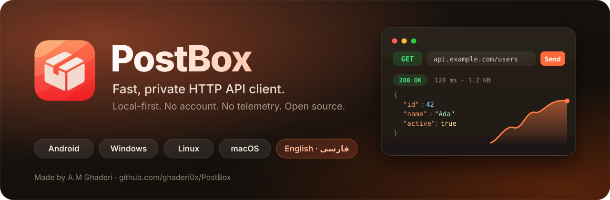
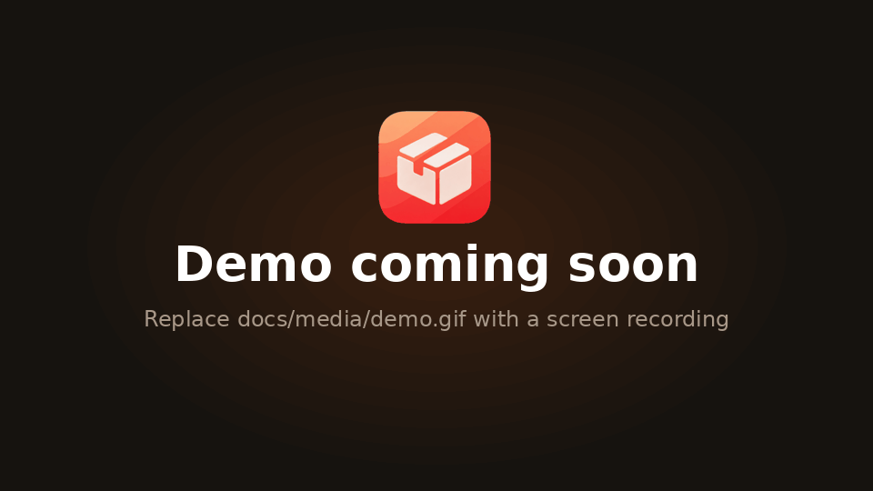

<div dir="rtl">

<p align="center">
  
</p>

<p align="center">
  <a href="https://github.com/ghaderi0x/PostBox/releases/latest"></a>
  <a href="https://github.com/ghaderi0x/PostBox/actions/workflows/ci.yml"></a>
  <a href="LICENSE"></a>
  
</p>

<p align="center">
  <a href="README.md">English</a> · <b>فارسی</b>
  &nbsp;|&nbsp;
  <a href="#-دانلود">دانلود</a> ·
  <a href="#-قابلیت‌ها">قابلیت‌ها</a> ·
  <a href="#-ساخت-از-روی-سورس">ساخت</a> ·
  <a href="docs/fa/RELEASE.md">راهنمای انتشار</a> ·
  <a href="CHANGELOG.md">تغییرات</a>
</p>

<p align="center">
  
</p>

## چرا پست‌باکس؟

پست‌باکس یک **کلاینت HTTP رایگان و متن‌باز** است که کاملاً روی دستگاه شما اجرا می‌شود. درخواست بفرستید، پاسخ را بررسی کنید، مجموعه‌ها را سازمان بدهید و تست اجرا کنید؛ بدون ساخت حساب کاربری، بدون ابر و بدون ارسال داده‌های‌تان به جایی.

| | |
|---|---|
| **محلی‌محور** | مجموعه‌ها، تاریخچه، محیط‌ها و کوکی‌ها در یک پایگاه داده روی دستگاه شما می‌مانند. بدون حساب، بدون سرور همگام‌سازی، بدون تله‌متری. |
| **حریم خصوصی** | رمزها در کیف‌کلید سیستم نگهداری می‌شوند، در رابط پنهان‌اند و مگر بخواهید در خروجی نمی‌آیند. |
| **مناسب پاسخ‌های بزرگ** | برنامه Flutter بومی است و پاسخ‌های طولانی با نمای خطی مجازی نمایش داده می‌شوند. |
| **همه‌جا** | یک کد برای اندروید، ویندوز، لینوکس و macOS با چیدمانی که با گوشی و دسکتاپ سازگار می‌شود. |
| **دوزبانه واقعی** | فارسی و انگلیسی با راست‌به‌چپ کامل و ارقام فارسی اختیاری. |

## ✨ قابلیت‌ها

**درخواست‌ها**
- همه متدهای HTTP و متد سفارشی، پارامتر و هدر با کلید روشن/خاموش
- بدنه: JSON، متن، فرم، چندبخشی، فایل باینری، GraphQL
- SSE و وب‌سوکت
- HTTP/2 (اختیاری)، کوکی، ریدایرکت، مهلت زمانی، پروکسی
- CA سفارشی، گواهی کلاینت (mTLS) و بازرسی گواهی

**احراز هویت**
- Basic، Bearer، کلید API
- OAuth 2.0 با Authorization Code و PKCE همراه تمدید توکن
- ارث‌بری احراز هویت و هدرها از پوشه یا مجموعه

**سازمان‌دهی**
- مجموعه، پوشه، علاقه‌مندی، الگو و جست‌وجو
- چند فضای کاری، هرکدام با پایگاه داده خودش
- تب‌های قابل جابه‌جایی؛ تب‌های باز پس از راه‌اندازی دوباره برمی‌گردند

**پاسخ‌ها**
- نمای مرتب، خام و تفاوت؛ درخت JSON با کپی JSONPath
- وضعیت، زمان، حجم، هدرها، کوکی‌ها و خط زمانی
- **نمودارها:** نمودار آبشاری زمان‌بندی، نتایج اجراگر و صفحه **آمار و نمودار** (نتیجه‌ها، زمان پاسخ، متدها، کندترین مسیرها)
- ذخیره در فایل و کپی به‌صورت cURL

**تست و خودکارسازی**
- ادعا روی وضعیت، هدر، بدنه، JSONPath و مدت
- متغیرهای سراسری، مجموعه، پوشه، درخواست، محیط و زمان اجرا
- زنجیره‌سازی، زبان اسکریپت کوچک داخلی، اجراگر مجموعه با تکرار، اجرای موازی و فایل داده CSV/JSON
- گزارش Markdown و JSON

**درون‌ریزی و برون‌بری**
- درون‌ریزی cURL، Postman، PostBox و OpenAPI-JSON
- برون‌بری cURL، Postman و PostBox

**ظاهر:** شش تم (از جمله کنتراست بالا)، رنگ تاکید دلخواه، تراکم راحت یا فشرده، اندازه متن، کاهش حرکت، پالت فرمان (<kbd>Ctrl</kbd>+<kbd>K</kbd>) و میان‌برهای قابل تغییر در دسکتاپ.

## 📦 دانلود

آخرین نسخه را از **[GitHub Releases](https://github.com/ghaderi0x/PostBox/releases/latest)** بگیرید. برای راستی‌آزمایی، فایل `SHA256SUMS.txt` همان‌جاست.

| پلتفرم | فایل | توضیح |
|---|---|---|
| **ویندوز** ۱۰/۱۱ | `PostBox-<version>-windows-setup.exe` | نصب‌کننده. فعلاً امضا نشده؛ اگر SmartScreen هشدار داد *More info ← Run anyway* را بزنید. |
| **macOS** | `PostBox-<version>-macos.dmg` | برنامه را به *Applications* بکشید. هنوز notarize نشده؛ بار اول روی آن راست‌کلیک و *Open* را بزنید. |
| **لینوکس** (دبیان/اوبونتو) | `postbox_<version>_amd64.deb` | `sudo apt install ./postbox_<version>_amd64.deb` |
| **لینوکس** (همه) | `PostBox-<version>-x86_64.AppImage` | `chmod +x PostBox-*.AppImage && ./PostBox-*.AppImage` |
| **اندروید** | `PostBox-<version>.apk` | در **مایکت** و **کافه‌بازار** هم هست. |

برای ذخیره رمزها در لینوکس به یک سرویس keyring (GNOME Keyring یا KWallet) نیاز است.

### به‌روزرسانی

هنگام اجرا، پست‌باکس از GitHub Releases همین مخزن آخرین نسخه را می‌پرسد. اگر نسخه جدیدی باشد، کارتی با تازه‌ها و دکمه‌های **به‌روزرسانی**، **بعداً** و **رد کردن این نسخه** نشان داده می‌شود. در ویندوز، لینوکس و macOS نصب‌کننده داخل برنامه دانلود و با `SHA256SUMS.txt` بررسی می‌شود؛ در اندروید کارت، مایکت یا بازار را باز می‌کند. می‌توانید این بررسی را در **تنظیمات ← درباره** خاموش کنید؛ تنها اتصالی است که پست‌باکس بدون درخواست شما برقرار می‌کند.

## 🛠 ساخت از روی سورس

به [Flutter SDK](https://docs.flutter.dev/get-started/install) نسخه ۳٫۳۵ یا بالاتر نیاز دارید.

</div>

```bash
git clone https://github.com/ghaderi0x/PostBox.git
cd PostBox

./tool/setup_platforms.sh          # ساخت پروژه‌های android/windows/linux/macos
flutter pub get
dart format . && flutter analyze && flutter test

flutter run -d windows             # یا linux، macos یا دستگاه اندروید
```

<div dir="rtl">

با `PLATFORMS=linux ./tool/setup_platforms.sh` فقط برخی پلتفرم‌ها ساخته می‌شوند. در ویندوز اسکریپت را در Git Bash یا WSL اجرا کنید.

## 🚀 انتشار

۱. `tool/bump_version.sh 1.0.1` و افزودن بخشی به `CHANGELOG.md`.
۲. کامیت، سپس `git tag v1.0.1 && git push origin main v1.0.1`.
۳. گردش‌کار **Release** نصب‌کننده ویندوز، دیسک‌ایمیج macOS، بسته‌های `.deb` و AppImage لینوکس را می‌سازد، `SHA256SUMS.txt` را می‌نویسد و انتشار GitHub را منتشر می‌کند.
۴. APK اندروید را خودتان بسازید و در همان انتشار، مایکت و بازار بارگذاری کنید.

## ⚠️ محدودیت‌های شناخته‌شده

- HTTP/3 پشتیبانی نمی‌شود؛ HTTP/2 اختیاری و فقط برای https بدون پروکسی است.
- OAuth 2.0 فقط Authorization Code با PKCE را پوشش می‌دهد.
- پیش‌نمایش صوت و تصویر و اعتبارسنجی JSON-Schema وجود ندارد.
- ساخت‌های ویندوز و macOS هنوز امضا یا notarize نشده‌اند. در macOS میان‌برهای پیش‌فرض با <kbd>Ctrl</kbd> هستند، نه <kbd>Cmd</kbd>؛ از **تنظیمات ← میان‌برها** عوض‌شان کنید.

فهرست کامل: [`docs/fa/PROJECT_STATUS.md`](docs/fa/PROJECT_STATUS.md).

## 📚 مستندات و مشارکت

مستندات: [`docs/fa/`](docs/fa) (فارسی) و [`docs/`](docs) (انگلیسی). برای مشارکت [`CONTRIBUTING.md`](CONTRIBUTING.md) و برای گزارش مشکل امنیتی [`SECURITY.md`](SECURITY.md) را بخوانید.

## 📄 مجوز

[MIT](LICENSE) © Uniqueone.

<p align="center">
  <sub>ساخته شده توسط <a href="https://github.com/ghaderi0x"><b>A.M Ghaderi</b></a></sub>
</p>

</div>
