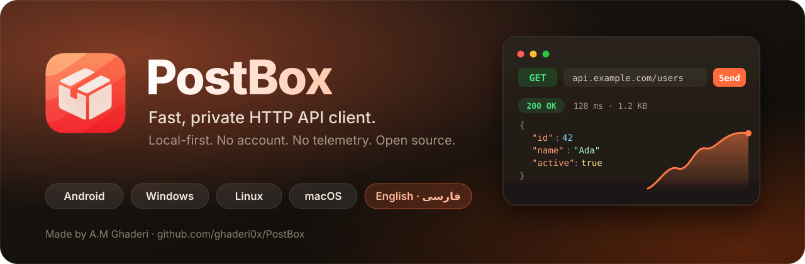
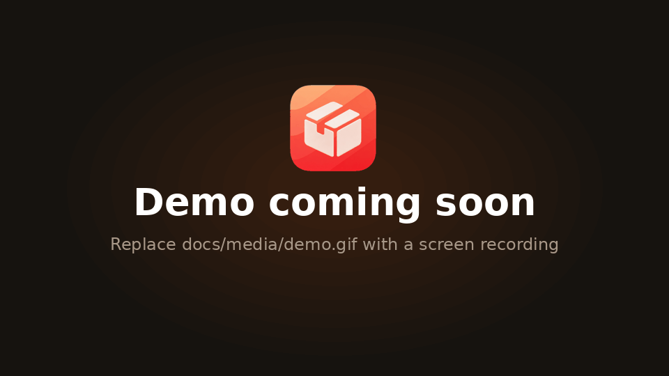

<p align="center">
  
</p>

<p align="center">
  <a href="https://github.com/ghaderi0x/PostBox/releases/latest"></a>
  <a href="https://github.com/ghaderi0x/PostBox/actions/workflows/ci.yml"></a>
  <a href="LICENSE"></a>
  
  
</p>

<p align="center">
  <b>English</b> · <a href="README.fa.md">فارسی</a>
  &nbsp;|&nbsp;
  <a href="#-download">Download</a> ·
  <a href="#-features">Features</a> ·
  <a href="#-build-from-source">Build</a> ·
  <a href="docs/RELEASE.md">Release guide</a> ·
  <a href="CHANGELOG.md">Changelog</a>
</p>

<p align="center">
  
</p>

## Why PostBox

PostBox is a **free, open-source HTTP API client** that lives entirely on your device. Send requests, inspect responses, organise collections and run test suites without creating an account, signing in to a cloud, or sending your data anywhere.

|   |   |
|---|---|
| **Local-first** | Collections, history, environments and cookies live in a database on your machine. No account, no sync server, no telemetry. |
| **Private by design** | Secrets sit in the system keystore, are masked in the UI and are left out of exports unless you ask. |
| **Built for big responses** | A native Flutter app. Long responses use a virtualised line view instead of one huge text widget. |
| **Everywhere** | One codebase for Android, Windows, Linux and macOS, with a layout that adapts to phone and desktop. |
| **Truly bilingual** | English and Persian with full right-to-left layout and optional Persian digits. |

## ✨ Features

<table>
<tr>
<td width="50%" valign="top">

**Requests**
- All HTTP methods, custom methods, params and headers with on/off switches
- Bodies: JSON, text, form, multipart, binary file, GraphQL
- Server-sent events and WebSocket
- HTTP/2 (opt-in), cookie jar, redirects, timeouts, proxy
- Custom CA, client certificates (mTLS), certificate inspection

**Auth**
- Basic, Bearer, API key
- OAuth 2.0 Authorization Code + PKCE with refresh
- Auth and headers inherited from folder or collection

**Organise**
- Collections, folders, favourites, templates, search
- Several workspaces, each with its own database
- Tabs you can reorder; open tabs restored after a restart

</td>
<td width="50%" valign="top">

**Responses**
- Pretty, raw and diff views; JSON tree with copy-JSONPath
- Status, time, size, headers, cookies, timing timeline
- **Charts:** timing waterfall, runner results, and an **Insights** page (outcomes, latency, methods, slowest endpoints)
- Save to file, copy as cURL

**Test and automate**
- Assertions on status, headers, body, JSONPath and duration
- Variables: global, collection, folder, request, environment, runtime
- Chaining, a small built-in script language, collection runner with iterations, parallel runs and CSV/JSON data files
- Markdown and JSON reports

**Import / export**
- Import cURL, Postman, PostBox, OpenAPI JSON
- Export cURL, Postman, PostBox

</td>
</tr>
</table>

**Look and feel:** six themes (including a high-contrast one), custom accent colour, comfortable or compact density, text scaling, reduced motion, a command palette (<kbd>Ctrl</kbd>+<kbd>K</kbd>) and rebindable keyboard shortcuts on desktop. Settings and the first-run tour have dedicated desktop layouts.

## 📦 Download

Get the latest build from **[GitHub Releases](https://github.com/ghaderi0x/PostBox/releases/latest)**. Check the `SHA256SUMS.txt` file there if you want to verify a download.

| Platform | File | Notes |
|---|---|---|
| **Windows** 10/11 | `PostBox-<version>-windows-setup.exe` | Installer. Unsigned for now, so SmartScreen may warn: choose *More info → Run anyway*. |
| **macOS** | `PostBox-<version>-macos.dmg` | Drag PostBox to *Applications*. Not notarised yet: on first launch right-click the app and choose *Open*. |
| **Linux** (Debian/Ubuntu) | `postbox_<version>_amd64.deb` | `sudo apt install ./postbox_<version>_amd64.deb` |
| **Linux** (any) | `PostBox-<version>-x86_64.AppImage` | `chmod +x PostBox-*.AppImage && ./PostBox-*.AppImage` |
| **Android** | `PostBox-<version>.apk` | Also on **Myket** and **Cafe Bazaar**. |

Linux needs a keyring service (GNOME Keyring or KWallet) so secrets can be stored.

### Updates

When PostBox starts it asks the GitHub Releases of this repository for the newest version. If there is one, a small card shows the release notes with **Update now**, **Later** and **Skip this version**. On Windows, Linux and macOS the installer is downloaded inside the app and checked against `SHA256SUMS.txt`; on Android the card opens Myket or Bazaar. You can turn the check off in **Settings → About**; it is the only connection PostBox makes that you did not ask for.

## ⌨️ Keyboard shortcuts (desktop)

| Action | Shortcut | Action | Shortcut |
|---|---|---|---|
| Send request | <kbd>Ctrl</kbd>+<kbd>Enter</kbd> | New tab | <kbd>Ctrl</kbd>+<kbd>T</kbd> |
| Save | <kbd>Ctrl</kbd>+<kbd>S</kbd> | Close tab | <kbd>Ctrl</kbd>+<kbd>W</kbd> |
| Command palette | <kbd>Ctrl</kbd>+<kbd>K</kbd> | Next / previous tab | <kbd>Ctrl</kbd>+<kbd>PgDn</kbd> / <kbd>PgUp</kbd> |

All of them can be changed in **Settings → Keyboard**. On macOS the defaults use <kbd>Ctrl</kbd>, not <kbd>Cmd</kbd>; rebind them there if you prefer.

## 🛠 Build from source

You need the [Flutter SDK](https://docs.flutter.dev/get-started/install) 3.35 or newer.

```bash
git clone https://github.com/ghaderi0x/PostBox.git
cd PostBox

./tool/setup_platforms.sh          # creates android/windows/linux/macos runners (see below)
flutter pub get
dart format . && flutter analyze && flutter test

flutter run -d windows             # or: linux, macos, or an Android device
```

`PLATFORMS=linux ./tool/setup_platforms.sh` sets up only some platforms. On Windows run the script in Git Bash or WSL.

| Platform | Needs |
|---|---|
| Windows | Visual Studio 2022 with *Desktop development with C++*, Developer Mode on |
| Linux | `clang cmake ninja-build pkg-config libgtk-3-dev libsecret-1-dev` |
| macOS | Xcode and CocoaPods |
| Android | Android SDK, JDK 17; then `dart run flutter_launcher_icons` and `dart run flutter_native_splash:create` |

Fonts (Inter, JetBrains Mono, Vazirmatn) are bundled; see `assets/fonts/README.md`.

## 🚀 Releasing

1. `tool/bump_version.sh 1.0.1` and add a section to `CHANGELOG.md`.
2. Commit, then `git tag v1.0.1 && git push origin main v1.0.1`.
3. The **Release** workflow builds the Windows installer, macOS disk image, Linux `.deb` and AppImage, writes `SHA256SUMS.txt` and publishes the GitHub Release.
4. Build the Android APK yourself and upload it to the release, Myket and Bazaar.

Details, signing notes and store listings: [`docs/RELEASE.md`](docs/RELEASE.md).

## 🧱 Project layout

```
lib/
  core/        design tokens, platform helpers, utilities
  features/    requests, collections, history, auth, runner, settings, update …
  l10n/        English and Persian strings
  ui/          pages and widgets (desktop and phone layouts)
test/          unit and widget tests
packaging/     Inno Setup, .deb, AppImage and .dmg scripts
tool/          platform setup and version bump scripts
docs/          architecture, security, privacy policy, release guide, feature matrix
```

## 📚 Documentation

[Product spec](docs/PRODUCT_SPEC.md) · [Architecture](docs/ARCHITECTURE.md) · [Design system](docs/DESIGN_SYSTEM.md) · [Security](docs/SECURITY.md) · [Privacy policy](docs/PRIVACY_POLICY.md) · [Import/export](docs/IMPORT_EXPORT.md) · [Scripting](docs/SCRIPTING.md) · [Testing](docs/TESTING.md) · [Feature matrix](docs/FEATURE_MATRIX.md) · [Roadmap](docs/ROADMAP.md) · [Project status](docs/PROJECT_STATUS.md) · فارسی: [`docs/fa/`](docs/fa)

## ⚠️ Known limits

- HTTP/3 is not supported; HTTP/2 is opt-in and applies to https without a proxy.
- OAuth 2.0 covers Authorization Code with PKCE only.
- No audio or video preview, no JSON-schema validation, no standalone environment file.
- Windows and macOS builds are not code-signed or notarised yet, and the Linux and macOS packages were produced by the release workflow rather than tested on every distribution or macOS version.

The full, dated list lives in [`docs/PROJECT_STATUS.md`](docs/PROJECT_STATUS.md).

## 🤝 Contributing

Issues and pull requests are welcome. Please read [`CONTRIBUTING.md`](CONTRIBUTING.md) and the [Code of Conduct](CODE_OF_CONDUCT.md); report security problems as described in [`SECURITY.md`](SECURITY.md).

## 📄 Licence

[MIT](LICENSE) © Uniqueone. Third-party notices: [`docs/THIRD_PARTY_NOTICES.md`](docs/THIRD_PARTY_NOTICES.md).

<p align="center">
  <sub>Made by <a href="https://github.com/ghaderi0x"><b>A.M Ghaderi</b></a> · <a href="https://github.com/ghaderi0x/PostBox">github.com/ghaderi0x/PostBox</a></sub>
</p>
